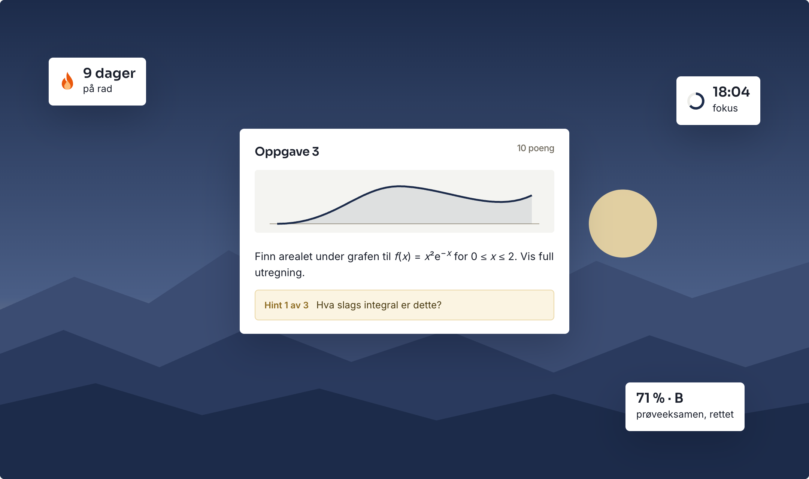

<p align="center">
  <picture>
    <source media="(prefers-color-scheme: dark)" srcset="docs/assets/eksamenshjelp_banner_dark.png">
    <source media="(prefers-color-scheme: light)" srcset="docs/assets/eksamenshjelp_banner_light.png">
    
  </picture>
</p>

<p align="center"><strong>Øv til eksamen, som på eksamen.</strong></p>

<p align="center">
  <a href="https://eksamenshjelp-one.vercel.app/">Nettside</a> ·
  <a href="https://github.com/thomas-schlytter/Eksamenshjelp/releases/latest">Last ned</a> ·
  <a href="#slik-fungerer-det">Slik fungerer det</a> ·
  <a href="#bygger-på-learnharness">Opphav</a>
</p>

Eksamenshjelp er en gratis app for NTNU-studenter som vil øve med AI på samme måte som på eksamen. Du får oppgaver i eksamensform med figurer, hint bare når du ber om det, og prøveeksamener som rettes med poeng og karakter. Appen bruker Claude- eller ChatGPT-abonnementet du allerede har. Alt er på norsk.

Laget av [Thomas Schlytter-Henrichsen](https://www.linkedin.com/in/thomas-schlytter-henrichsen-0b4182296/), basert på [LearnHarness](https://github.com/amosblomqvist/learnharness).



## Kom i gang

1. Gå til **[eksamenshjelp-one.vercel.app](https://eksamenshjelp-one.vercel.app/)** og velg «Jeg har Claude» eller «Jeg har ChatGPT».
2. Trykk «Kopier» og lim teksten inn i Code-fanen i Claude-appen eller i Codex.
3. Den installerer Eksamenshjelp, lager én mappe per fag og henter tidligere eksamener fra Canvas eller fagets wiki.

Du trenger en Mac med Apple-brikke eller en Windows-PC, og Claude Pro/Max eller ChatGPT Plus/Pro. Selve nedlastingen bruker ingen tokens: installasjonsskriptet henter appen direkte fra [GitHub Releases](https://github.com/thomas-schlytter/Eksamenshjelp/releases/latest).

Appen er ikke signert hos Apple eller Microsoft. Kommer det en ny versjon, viser appen et varsel med nedlastingslenke.

## Slik fungerer det

**Ett fag, én chat.** Hvert fag har sin egen chat der agenten kjenner pensum, tidligere eksamener og hva du kan. Vil du gå dypere i noe, åpner du en underchat som går rett på sak.

**Oppgaver som på eksamen.** Figuren står i oppgaveteksten før du begynner. Står du fast, trykker du **Hint**, og hintene blir gradvis tydeligere. Du kan også spørre agenten uten at oppgaven forsvinner, og legge inn besvarelsen din som bilde eller PDF.

**Prøveeksamen.** Agenten lager en PDF i samme form som tidligere eksamener. Du svarer på papir eller i appen og får poeng per oppgave og karakter etter NTNU-skalaen. Planen justeres etter resultatet. Med «Hard mode» leveres besvarelsen automatisk når tiden er ute, som på ekte eksamen.

**Avslutt økt.** Trykk **Avslutt økt** når du er ferdig. Du velger mellom en kort oppsummering med quiz (3–10 spørsmål, etter hvor mye du har gått gjennom) eller å bare avslutte. Temaene på fagsiden oppdateres.

**Fagsiden.** Her ser du dager til eksamen, om du er på god vei, hvor mange temaer som er grønne, karakterkurven fra prøveeksamenene og hva du bør jobbe med nå.

**Flammen.** Løser du minst én oppgave om dagen, vokser flammen fra Gnist til Blå flamme. «Vet ikke» teller ikke.

**Fokus.** En tidtaker i toppen av fagchatten med 25 + 5, 50 + 10 eller 90 + 15 minutter, eller din egen lengde. Du får varsel når det er pause.

**Kunnskapskartet.** Det du lærer, samles som påstander med kilder, gruppert etter fag og tema. Senere økter bygger videre på kartet i stedet for å begynne fra bunnen av.

## Tokenbruk

Eksamenshjelp tømmer ikke abonnementet. Faste deler av samtalen gjenbrukes fra hurtigbufferen, så hvert svar koster lite nytt. Tallene ligger på [nettsiden](https://eksamenshjelp-one.vercel.app/), under «Tømmer ikke abonnementet».

## Personvern og lagring

- **Lokalt.** Fag, chatter, kunnskapskart og innstillinger ligger på maskinen din. Fagmappene ligger i `~/Documents/Eksamenshjelp/<FAGKODE>/`, og appen følger med på dem.
- **Ingen konto.** Eksamenshjelp har ingen egen konto og ingen innebygd AI-tjeneste. Du kobler til Claude eller ChatGPT selv.
- **Eksterne tjenester.** Modellene kjører hos Anthropic eller OpenAI. Appen henter emneinformasjon fra NTNUs emnesider. Diktering (Deepgram) og nettsøk er valgfritt og bruker egne nøkler.
- **Innsyn.** Instruksene til agentene kan leses og redigeres i appen, og kildekoden er åpen.

Har du brukt LearnHarness før, kan du ta med øktene og kunnskapskartet under **Innstillinger → Generelt → Importer fra LearnHarness**. Importen legger bare til og tar sikkerhetskopi først.

## Kjør fra kildekoden

```bash
npm install
npm run dev        # http://localhost:3000
npm test           # uten LLM og uten nettverk
```

Se [utviklerguiden](docs/development.md), [arkitekturen](docs/architecture.md) og [guiden for skrivebordsutgivelser](docs/desktop-release.md). Dokumentasjonen under `docs/` er på engelsk og beskriver i hovedsak originalprosjektet.

## Bygger på LearnHarness

Eksamenshjelp er en videreutvikling av **[LearnHarness](https://github.com/amosblomqvist/learnharness)** av **Amos Blomqvist**. Læringsmotoren, agentene, kunnskapskartet og skrivebordsappen er hans arbeid. Denne versjonen legger til fag med NTNU-kontekst, eksamensoppgaver med hint, prøveeksamener med retting, fagsiden, flammen, Fokus og norsk språk.

Eksamenshjelp er ikke en offisiell utgave av LearnHarness og er ikke tilknyttet NTNU.

## Lisens

[AGPL-3.0](LICENSE), samme lisens som originalprosjektet.
